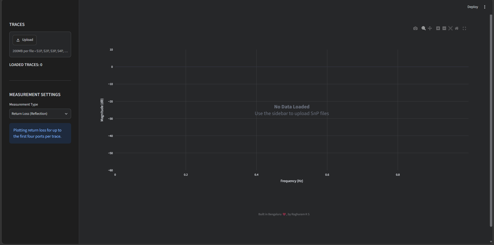
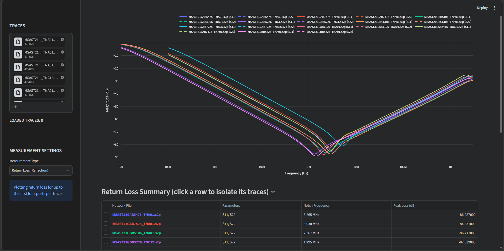

# Touchstone Viewer

A lightweight web application for RF and signal-integrity engineers to inspect
Touchstone (`.sNp`) files with up to 32 ports. Built with Python, Streamlit,
Plotly, and scikit-rf.

## Screenshots



*Main interface with S-parameter traces and interactive trace isolation.*



*Grouped measurement summary with comparative traces.*

## Features

- **Measurement modes:** Plot Return Loss (reflection), Insertion Loss
  (transmission), or a manually selected S-parameter.
- **Port mapping:** Choose sequential or split/bipartite pairings for
  multi-port insertion measurements.
- **Grouped traces:** View multiple S-parameters per file with a shared file
  color and distinct line styles. Select a summary row to isolate that file's
  traces.
- **Notch summaries:** Display each file's primary notch frequency and peak
  magnitude, with a marker on the plot.
- **Passivity status:** Check the maximum singular value across frequency
  points and report the network's passivity status.
- **Port limit:** Files with more than 32 ports are rejected.

## Requirements

- Python 3.9 or later
- pip

## Installation

Create and activate a virtual environment, then install the dependencies:

```powershell
python -m venv .venv
.\.venv\Scripts\Activate.ps1
python -m pip install -r requirements.txt
```

On macOS or Linux, activate the environment with:

```bash
source .venv/bin/activate
python -m pip install -r requirements.txt
```

## Usage

Start the app from the project directory:

```bash
python -m streamlit run app.py
```

Open the local URL printed by Streamlit, usually `http://localhost:8501`.
Upload one or more Touchstone files, choose a measurement type, and select a
port-mapping assumption when applicable.

Built in Bengaluru ❤️, by Raghuram K S
